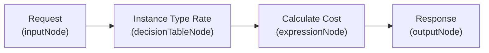
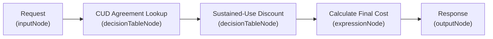

# GoRules Decision Models & Authoring Guide

Comprehensive guide to the GoRules (Zen engine) programmable decision models used in the OSAC Cost Management system. This document explains the architecture, execution engine, input/output contracts, breaks down the two production rules (`compute-pricing.json` and `committed-use-pricing.json`), and provides a step-by-step tutorial for authoring, uploading, and linking new decision models.

**See also:**
- [Rate Configuration & Pricing Guide](rate-configuration-guide.md) — rate forms, 3-in-1 model selection, and UI assignment.
- [API Reference](api-reference.md) — REST endpoints for `/api/v1/rules` and `/api/v1/rates`.
- [Data Model](data-model.md) — PostgreSQL schemas for `pricing_rules` and `rates`.
- [GoRules Rule Diagrams](research/gorules-rule-diagrams.md) — high-level visual decision graphs.

---

## 1. GoRules & Zen Engine Architecture

The cost management system embeds **Zen Go** (`github.com/gorules/zen-go`), an ultra-fast compiled Rust decision engine that evaluates JSON Decision Models (JDMs) in microseconds.

```
                         Unrated Metering Entry
                                  │
                                  ▼
                      matchRate(rates table)
                                  │
                                  ├─ rate.RuleName == ""  ──▶ Tiered or Flat Calculation
                                  │
                                  └─ rate.RuleName != ""
                                          │
                                          ▼
                             Fetch Decision Model
                         (from Zen in-memory cache)
                                          │
                                          ▼
                               Pass PricingInput
                                          │
                                          ▼
                             Evaluate Decision DAG
                     (Input ──▶ Tables ──▶ Expressions ──▶ Output)
                                          │
                                          ▼
                                PricingOutput
                                          │
                                          ▼
                             Insert Cost Entry
                        (stamped with rate.ID)
```

### Key Properties
- **Zero-Downtime Hot Reloading**: Rule definitions are stored in PostgreSQL (`pricing_rules` table). When a rule is added or updated via `POST /api/v1/rules` or the web UI, the engine automatically increments the revision version and reloads the Zen cache on the next rating sweep without restarting the process.
- **Rate-Card Binding**: Rules are not global overrides; they are bound to specific rate cards via `rates.rule_name`. A rate card matches catalog items, machine types, tenants, and meters, then delegates calculation to its bound rule.
- **Deterministic DAG**: Each rule is represented as a directed acyclic graph composed of nodes (inputs, decision tables, expressions, outputs) connected by edges.

---

## 2. Input & Output Contract

Every GoRule evaluated by the rating engine receives a standardized input context and must produce a standardized output object.

### Input Context (`PricingInput`)

When the rating engine invokes `r.rules.EvaluateRate(rate.RuleName, input)`, it populates the following fields:

| Field | Type | Description | Example |
| :--- | :--- | :--- | :--- |
| `instance_type` | `string` | Sizing spec or machine shape from inventory / event | `"standard-2-8"`, `"standard-4-16"` |
| `catalog_item` | `string` | OSAC catalog offering name or SKU | `"sim-catalog-standard"`, `"ai-cluster-xl"` |
| `tenant_tier` | `string` | Tenant service tier resolved from tenant metadata | `"gold"`, `"silver"`, `""` |
| `tenant_id` | `string` | Tenant identifier / namespace | `"tenant-acme"`, `"tenant-globex"` |
| `resource_type` | `string` | Cloud resource classification | `"compute_instance"`, `"cluster"`, `"model"` |
| `meter_name` | `string` | Name of the metered metric being rated | `"vm_uptime_seconds"`, `"maas_tokens_in"` |
| `value` | `number` | Raw metered consumption value | `3600.0` (seconds), `1500000.0` (tokens) |

> [!NOTE]
> Additional custom parameters (such as `monthly_utilization_pct`, `running_vms`, or `base_price_per_hour`) can be passed through intermediate decision tables or derived dynamically within rule nodes.

### Output Contract (`PricingOutput`)

The output node of your decision model must expose the following fields:

| Field | Type | Required | Description | Example |
| :--- | :--- | :--- | :--- | :--- |
| `cost_amount` | `number` | **Yes** | Total calculated billable dollar amount ($) | `0.16` |
| `effective_rate` | `number` | **Yes** | Effective rate applied ($/hour or $/unit) | `0.16` |
| `currency` | `string` | **Yes** | Three-letter currency code | `'USD'` |
| `description` | `string` | No | Human-readable explanation of discount/rule applied | `'4 cores 16GB Gold (20% off)'` |
| `price_per_hour` | `number` | No | Base hourly price before discounts | `0.20` |
| `discount_pct` | `number` | No | Percentage discount applied (0 to 100) | `20` |

---

## 3. Deep Dive: Rule 1 — `compute-pricing.json`

### Overview
- **Rule Name**: `compute-pricing.json`
- **Target Meter**: `vm_uptime_seconds` (or catalog offerings)
- **Business Purpose**: Maps machine instance types and tenant subscription tiers (e.g., Gold, Standard) to base hourly rates and automatic loyalty discounts.

### Decision Graph Architecture



### Node Breakdown

#### 1. Input Node (`input-1`)
Accepts the raw request containing `instance_type`, `tenant_tier`, `catalog_item`, and `value` (uptime seconds).

#### 2. Decision Table Node (`instance-rate`)
- **Hit Policy**: `first` (evaluates rules from top to bottom and stops on the first match).
- **Inputs**:
  - `col-catalog`: `catalog_item` (expression)
  - `col-itype`: `instance_type` (expression)
  - `col-tier`: `tenant_tier` (expression)
- **Outputs**:
  - `price_per_hour`: Base price in $/hour
  - `discount_pct`: Applied discount %
  - `description`: Billing line item description
  - `value`: Passthrough of metered uptime seconds

**Rule Table Matrix**:

| Rule ID | Catalog Item | Instance Type | Tenant Tier | Price/Hour ($) | Discount % | Description |
| :--- | :--- | :--- | :--- | :--- | :--- | :--- |
| `catalog-live-vm-standard` | `"catalog-live-vm-standard"` | *(any)* | *(any)* | `$0.30` | `0` | `'catalog-live-vm-standard via GoRule ($0.30/hr)'` |
| `r1` | *(any)* | `"standard-2-8"` | `"gold"` | `$0.10` | `20` | `'2 cores 8GB Gold (20% off)'` |
| `r2` | *(any)* | `"standard-2-8"` | *(any)* | `$0.10` | `0` | `'2 cores 8GB standard'` |
| `r3` | *(any)* | `"standard-4-16"` | `"gold"` | `$0.20` | `20` | `'4 cores 16GB Gold (20% off)'` |
| `r4` | *(any)* | `"standard-4-16"` | *(any)* | `$0.20` | `0` | `'4 cores 16GB standard'` |
| `r5` | *(any)* | `"standard-8-32"` | `"gold"` | `$0.40` | `20` | `'8 cores 32GB Gold (20% off)'` |
| `r6` | *(any)* | `"standard-8-32"` | *(any)* | `$0.40` | `0` | `'8 cores 32GB standard'` |
| `r-default` | *(any)* | *(any)* | *(any)* | `$0.10` | `0` | `'unknown instance type - default rate'` |

#### 3. Expression Node (`calc-cost`)
Computes billable amounts from the selected hourly rate:
```javascript
// Cost calculation formula
cost_amount    = (value / 3600) * price_per_hour * (1 - discount_pct / 100)
effective_rate = price_per_hour * (1 - discount_pct / 100)
currency       = 'USD'
```

### Worked Examples

#### Example A: Standard Tenant on 4 vCPU VM
- **Input**: `instance_type = "standard-4-16"`, `tenant_tier = ""`, `value = 3600` (1 hour)
- **Matched Rule**: `r4` (`price_per_hour = 0.20`, `discount_pct = 0`)
- **Calculation**: $(3600 / 3600) \times 0.20 \times (1 - 0) = \mathbf{\$0.20}$
- **Output**: `cost_amount: 0.20`, `effective_rate: 0.20`, `description: "4 cores 16GB standard"`

#### Example B: Gold VIP Tenant on 4 vCPU VM
- **Input**: `instance_type = "standard-4-16"`, `tenant_tier = "gold"`, `value = 3600` (1 hour)
- **Matched Rule**: `r3` (`price_per_hour = 0.20`, `discount_pct = 20`)
- **Calculation**: $(3600 / 3600) \times 0.20 \times (1 - 0.20) = \mathbf{\$0.16}$
- **Output**: `cost_amount: 0.16`, `effective_rate: 0.16`, `description: "4 cores 16GB Gold (20% off)"`

---

## 4. Deep Dive: Rule 2 — `committed-use-pricing.json`

### Overview
- **Rule Name**: `committed-use-pricing.json`
- **Target Resource**: Enterprise commitments and high-volume workloads
- **Business Purpose**: Implements multi-tier enterprise billing:
  1. If usage is within a tenant's **Committed-Use Discount (CUD)** agreement, apply fixed contractual discounts (40% - 50%).
  2. If usage exceeds the commitment, evaluate **Sustained-Use Utilization %** to reward high utilization with graduated discounts (up to 30%).
  3. If no agreement exists and utilization is low, bill at standard **On-demand** rates.

### Decision Graph Architecture



### Node Breakdown

#### 1. Node 1: CUD Agreement Lookup (`cud-lookup`)
- **Hit Policy**: `first`
- **Inputs**: `tenant_id`, `resource_type`
- **Outputs**: `committed_qty`, `cud_discount_pct`, `commitment_type`, plus passthrough of input dimensions.

| Tenant ID | Resource Type | Committed VMs | CUD Discount % | Commitment Type |
| :--- | :--- | :--- | :--- | :--- |
| `"tenant-acme"` | `"compute_instance"` | `5` | `40` | `'1-year'` |
| `"tenant-globex"` | `"compute_instance"` | `10` | `50` | `'1-year'` |
| *(any)* | *(any)* | `0` | `0` | `'none'` |

#### 2. Node 2: Sustained-Use Discount (`sustained-use`)
- **Hit Policy**: `first`
- **Input**: `monthly_utilization_pct`
- **Output**: `sustained_discount_pct`, plus passthrough fields.

| Monthly Utilization % | Sustained Discount % |
| :--- | :--- |
| `>= 100` | `30%` |
| `>= 75` | `20%` |
| `>= 50` | `10%` |
| `>= 25` | `5%` |
| *(any)* | `0%` |

#### 3. Node 3: Final Cost Calculation (`calc-cost`)
Evaluates conditionals using Zen expressions:

```javascript
// Step 1: Check whether running VMs are within commitment
within_commitment = committed_qty > 0 and running_vms <= committed_qty

// Step 2: Pick effective discount percentage
effective_discount_pct = within_commitment ? cud_discount_pct : sustained_discount_pct

// Step 3: Compute dollar cost
cost_amount = (value / 3600) * base_price_per_hour * (1 - effective_discount_pct / 100)
effective_rate = base_price_per_hour * (1 - effective_discount_pct / 100)

// Step 4: Generate audit label
description = within_commitment ? ('CUD ' + commitment_type) : (sustained_discount_pct > 0 ? 'Sustained-use' : 'On-demand')
```

### Worked Examples

| Tenant | Running VMs | Committed | Utilization | Base Price | Discount Applied | Cost (1 hr) | Label |
| :--- | :--- | :--- | :--- | :--- | :--- | :--- | :--- |
| `tenant-acme` | `3` | `5` | `80%` | `$0.20/hr` | **40% CUD** | **$0.12** | `CUD 1-year` |
| `tenant-acme` | `8` | `5` | `80%` | `$0.20/hr` | **20% Sustained** | **$0.16** | `Sustained-use` |
| `tenant-initech` | `2` | `0` | `15%` | `$0.20/hr` | **0% (On-demand)** | **$0.20** | `On-demand` |
| `tenant-globex` | `8` | `10` | `95%` | `$0.40/hr` | **50% CUD** | **$0.20** | `CUD 1-year` |

---

## 5. Authoring a New GoRule (Step-by-Step)

Follow this guide to author a custom pricing rule from scratch.

### Step 1: Design the Decision Flow
Determine:
1. What inputs does your rule need? (e.g. `instance_type`, `catalog_item`, `tenant_tier`, `value`).
2. Does it need a decision table, an expression formula, or a pipeline of both?
3. What is the formula for `cost_amount` and `effective_rate`?

### Step 2: Create the JSON Structure
Create a `.json` file following the Zen JDM specification:

```json
{
  "nodes": [
    {
      "id": "input-1",
      "type": "inputNode",
      "position": {"x": 100, "y": 200},
      "name": "Request"
    },
    {
      "id": "rate-table",
      "type": "decisionTableNode",
      "position": {"x": 400, "y": 200},
      "name": "Pricing Table",
      "content": {
        "hitPolicy": "first",
        "inputs": [
          {"field": "catalog_item", "id": "col-cat", "name": "Catalog Item", "type": "expression"},
          {"field": "tenant_tier", "id": "col-tier", "name": "Tenant Tier", "type": "expression"}
        ],
        "outputs": [
          {"field": "price_per_unit", "id": "col-price", "name": "Price/Unit ($)", "type": "expression"},
          {"field": "discount_pct", "id": "col-disc", "name": "Discount %", "type": "expression"},
          {"field": "value", "id": "col-val", "name": "Value (pass)", "type": "expression"}
        ],
        "rules": [
          {
            "_id": "r1",
            "col-cat": "\"ai-cluster-xl\"",
            "col-tier": "\"gold\"",
            "col-price": "1.50",
            "col-disc": "15",
            "col-val": "value"
          },
          {
            "_id": "r2",
            "col-cat": "\"ai-cluster-xl\"",
            "col-tier": "",
            "col-price": "1.50",
            "col-disc": "0",
            "col-val": "value"
          },
          {
            "_id": "default-rule",
            "col-cat": "",
            "col-tier": "",
            "col-price": "1.00",
            "col-disc": "0",
            "col-val": "value"
          }
        ]
      }
    },
    {
      "id": "calc-cost",
      "type": "expressionNode",
      "position": {"x": 700, "y": 200},
      "name": "Calculate Cost",
      "content": {
        "expressions": [
          {"id": "e1", "key": "cost_amount", "value": "value * price_per_unit * (1 - discount_pct / 100)"},
          {"id": "e2", "key": "effective_rate", "value": "price_per_unit * (1 - discount_pct / 100)"},
          {"id": "e3", "key": "currency", "value": "'USD'"},
          {"id": "e4", "key": "description", "value": "'AI Cluster billing with ' + string(discount_pct) + '% discount'"}
        ]
      }
    },
    {
      "id": "output-1",
      "type": "outputNode",
      "position": {"x": 1000, "y": 200},
      "name": "Response"
    }
  ],
  "edges": [
    {"id": "e1", "sourceId": "input-1", "targetId": "rate-table", "type": "edge"},
    {"id": "e2", "sourceId": "rate-table", "targetId": "calc-cost", "type": "edge"},
    {"id": "e3", "sourceId": "calc-cost", "targetId": "output-1", "type": "edge"}
  ]
}
```

### Step 3: Syntax Rules & Best Practices

> [!IMPORTANT]
> **String Literals in Decision Table Conditions**:
> In Zen expression inputs, string literals must be enclosed in escaped quotes: `"\"gold\""` or `"\"ai-cluster-xl\""`. An unquoted word like `"gold"` is treated as a variable lookup.
>
> To match **any value** (wildcard), leave the field as an empty string `""`.

> [!TIP]
> **Expressions Syntax**:
> Expression values support standard operators (`+`, `-`, `*`, `/`, `? :`), logical operators (`and`, `or`, `not`), and comparisons (`==`, `!=`, `<`, `<=`, `>`, `>=`).
> For string constants in expressions, use single quotes: `'USD'`.

### Step 4: Upload the Rule

#### Option A: Web UI (`/ui/rates`)
1. Navigate to `http://localhost:8020/ui/rates`.
2. Click the **GoRules Decision Models** tab.
3. Click **+ Add Decision Model**.
4. Enter the model name (e.g. `gpu-cluster-pricing.json`) and paste your JSON definition.
5. Click **Save Decision Model**. The engine immediately compiles and caches the rule.

#### Option B: REST API (`/api/v1/rules`)
```bash
curl -X POST http://localhost:8020/api/v1/rules \
  -H "Content-Type: application/json" \
  -d '{
    "name": "gpu-cluster-pricing.json",
    "rule_json": { ... }
  }'
```

### Step 5: Link the Rule to a Rate Card
To activate your rule, bind it to a rate card:

#### Option A: Web UI (`/ui/rates`)
1. In the **Catalog Items** or **Active Rate Cards** table, click **Assign Rate** or **+ Add Rate Card**.
2. In the modal, select the **GoRule** card.
3. Choose your rule from the **Select GoRule Decision Model** dropdown (e.g. `gpu-cluster-pricing.json`).
4. Select the matching catalog item or machine type and meter name.
5. Click **Save Rate Card**.

#### Option B: REST API (`/api/v1/rates`)
```bash
curl -X POST http://localhost:8020/api/v1/rates \
  -H "Content-Type: application/json" \
  -d '{
    "resource_type": "compute_instance",
    "catalog_item": "ai-cluster-xl",
    "meter_name": "vm_uptime_seconds",
    "rule_name": "gpu-cluster-pricing.json",
    "price_per_unit": "0",
    "description": "Dynamic GPU pricing rule"
  }'
```

On the next rating sweep, any unrated entries matching `catalog_item = "ai-cluster-xl"` will execute `gpu-cluster-pricing.json` and generate cost entries tagged with that rate card ID.
