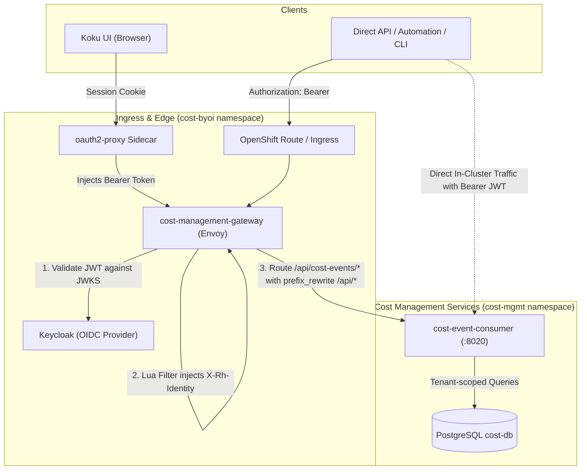
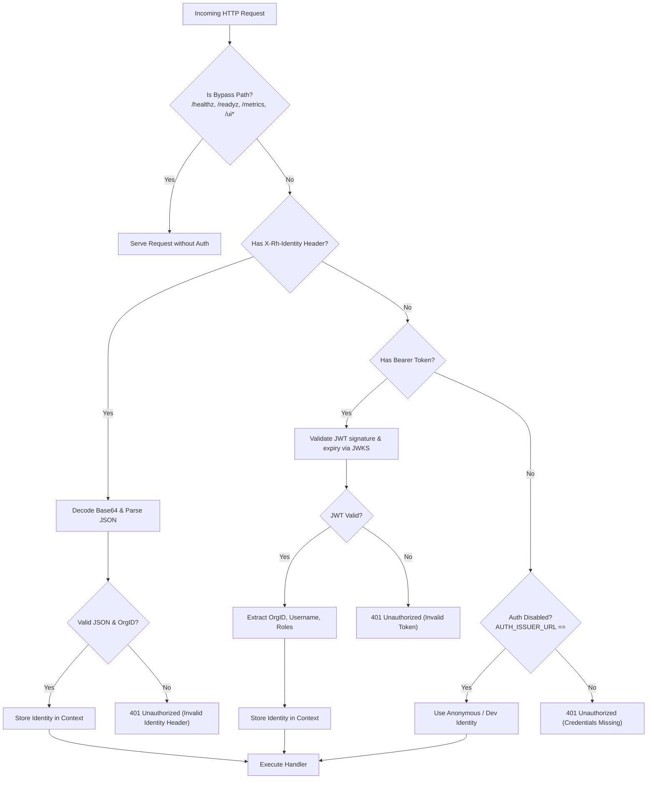

# Koku On-Prem API Authentication & Tenant Isolation Design

## 1. Executive Summary

To integrate the `cost-event-consumer` service with the on-premises Koku architecture (managed by `koku-service-operator`), this design specifies:
1. **Gateway Path Mapping**: External path `/api/cost-events/` mapped via Envoy `prefix_rewrite: "/api/"` to our backend service at `/api/`.
2. **Dual-Authentication Strategy**:
   - **Gateway Mode**: Parse and trust the base64-encoded `X-Rh-Identity` header synthesized by Envoy's Lua filter after Envoy validates the JWT against Keycloak.
   - **Direct Bearer Mode**: Support direct incoming `Authorization: Bearer <JWT>` tokens validated against Keycloak JWKS for direct API/CLI access and local development.
3. **Tenant Scoping & Isolation**:
   - Extract `OrgID` and administrative status (`IsOrgAdmin`) from identity.
   - Restrict regular users to their assigned `OrgID` (returning `403 Forbidden` if attempting to access another tenant).
   - Allow organization administrators (`is_org_admin: true`) to query across tenants or specify any tenant.
4. **Envoy Gateway Configuration**: Update `koku-service-operator` to declare the `cost-events-backend` cluster and routing rules.

---

## 2. Architecture & Request Flow



### 2.1 Route & Path Mapping

Envoy route definition in `koku-service-operator`:

| Incoming External URL | Envoy `prefix_rewrite` | Target Service URL (`cost-event-consumer:8020`) |
| :--- | :--- | :--- |
| `GET /api/cost-events/v1/reports/costs` | `/api/` | `GET /api/v1/reports/costs` |
| `GET /api/cost-events/v1/reports/breakdown` | `/api/` | `GET /api/v1/reports/breakdown` |
| `GET /api/cost-events/v1/quotas/{tenant_id}` | `/api/` | `GET /api/v1/quotas/{tenant_id}` |
| `POST /api/cost-events/v1/events/batch` | `/api/` | `POST /api/v1/events/batch` |
| `GET /api/cost-events/v1/openapi.json` | `/api/` | `GET /api/v1/openapi.json` |

> [!NOTE]
> `prefix_rewrite: "/api/"` ensures the backend `cost-event-consumer` does not require changing its internal router prefix (`/api`), preserving compatibility with existing tests, direct cluster internal consumers, and local port-forwards.

---

## 3. Identity & Authentication Specification

### 3.1 Identity Structure

Envoy constructs the standard Red Hat Insights `X-Rh-Identity` header:

```json
{
  "org_id": "123456",
  "identity": {
    "org_id": "123456",
    "account_number": "123456",
    "type": "User",
    "user": {
      "username": "koku-user",
      "email": "user@example.com",
      "is_org_admin": false
    }
  },
  "entitlements": {
    "cost_management": {
      "is_entitled": true
    }
  }
}
```

The parsed representation in Go (`internal/authn/identity.go`):

```go
type Identity struct {
    OrgID         string
    AccountNumber string
    Username      string
    Email         string
    IsOrgAdmin    bool
    RawAuthType   string // "x-rh-identity" or "bearer-jwt"
}
```

### 3.2 Dual-Auth Resolution Logic



---

## 4. Tenant Isolation & Authorization Enforcement

In `internal/api/handler.go`, handlers check the context's `Identity`:

1. **Regular User (`IsOrgAdmin == false`)**:
   - If a `tenant_id` query/path parameter is supplied:
     - Check `req_tenant_id == identity.OrgID`.
     - If mismatch, respond with `HTTP 403 Forbidden`:
       ```json
       {"error": "forbidden: tenant mismatch"}
       ```
   - If no `tenant_id` query parameter is provided (e.g. `GET /api/v1/reports/costs`):
     - Implicitly force `tenant_id = identity.OrgID` in the query filter.
2. **Organization Administrator (`IsOrgAdmin == true`)**:
   - Allowed to specify any `tenant_id` to inspect sub-tenants or accounts.
   - Allowed to omit `tenant_id` to query aggregated costs across all tenants.

---

## 5. Gateway Route Definition (`koku-service-operator`)

In `koku-service-operator/internal/resources/envoy.go`:

### Cluster Definition
```yaml
- name: cost-events-backend
  connect_timeout: 0.25s
  type: STRICT_DNS
  dns_lookup_family: V4_ONLY
  lb_policy: ROUND_ROBIN
  load_assignment:
    cluster_name: cost-events-backend
    endpoints:
    - lb_endpoints:
      - endpoint:
          address:
            socket_address:
              address: cost-event-consumer.cost-mgmt.svc.cluster.local
              port_value: 8020
```

### Route Entry
```yaml
- match:
    prefix: "/api/cost-events/"
  route:
    cluster: cost-events-backend
    timeout: 60s
    prefix_rewrite: "/api/"
```

Placed alongside routes for `/api/cost-management/v1/` (`koku-backend`), `/api/ingress/v1/` (`ingress-backend`), etc.

---

## 6. Implementation Plan

1. **Step 1: Authn Identity & Parser (`internal/authn`)**:
   - Create `internal/authn/identity.go` with `Identity` model, `ParseXRhIdentity(raw string) (*Identity, error)`, and context helpers (`WithIdentity`, `IdentityFromContext`).
   - Enhance `internal/authn/middleware.go` to support dual-auth (Gateway `X-Rh-Identity` header + Direct `Bearer JWT`).
   - Add unit tests in `internal/authn/middleware_test.go`.

2. **Step 2: Tenant Scoping in API Handlers (`internal/api/handler.go`)**:
   - Enforce tenant validation in `GetCostReport`, `GetBreakdownReport`, and `GetQuotas`.
   - Add unit tests in `internal/api/handler_test.go` verifying 401 on missing credentials, 403 on tenant mismatch, and successful scoped queries.

3. **Step 3: Operator Gateway Configuration (`koku-service-operator`)**:
   - Add the cluster and route in `koku-service-operator/internal/resources/envoy.go`.
   - Verify operator tests and envoy config generation.

4. **Step 4: Verification & Smoke Test**:
   - Run unit test suite: `go test -race ./internal/authn ./internal/api`.
   - Test `X-Rh-Identity` header injection against the live port-forwarded service.
