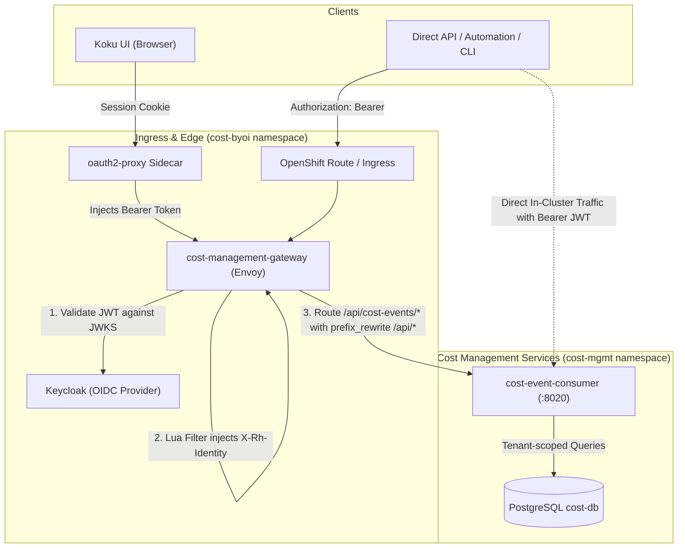
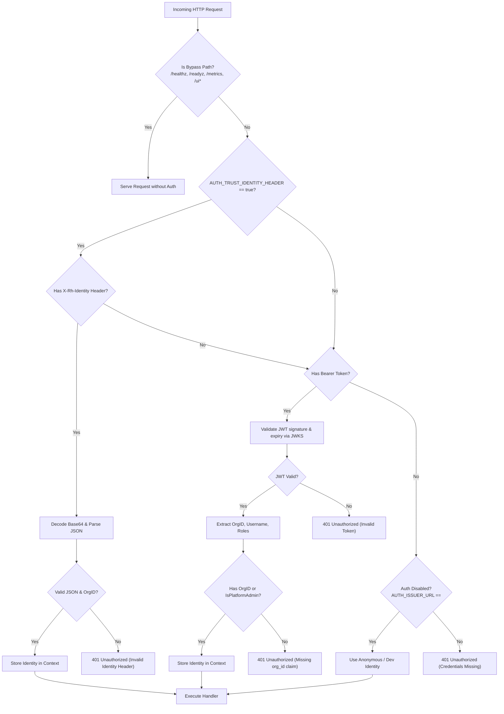

# Koku On-Prem API Authentication & Tenant Isolation Design

## 1. Executive Summary

To integrate the `cost-event-consumer` service with the on-premises Koku architecture (managed by `koku-service-operator`), this design specifies:
1. **Gateway Path Mapping**: External path `/api/cost-events/` mapped via Envoy `prefix_rewrite: "/api/"` to our backend service at `/api/`.
2. **Dual-Authentication Strategy**:
   - **Gateway Mode**: Parse and trust the base64-encoded `X-Rh-Identity` header synthesized by Envoy's Lua filter after Envoy validates the JWT against Keycloak. This mode is gated behind the configuration setting `AUTH_TRUST_IDENTITY_HEADER=true` (default: `false`). The gateway must strip any client-supplied `X-Rh-Identity` headers before injecting its own.
   - **Direct Bearer Mode**: Support direct incoming `Authorization: Bearer <JWT>` tokens validated against Keycloak JWKS for direct API/CLI access and local development. Bearer tokens must contain an `org_id` claim unless the principal is a platform administrator.
3. **Tenant Scoping & Multi-Level Authorization**:
   - Extract `OrgID`, `IsOrgAdmin` (organization-scoped administrator), and `IsPlatformAdmin` (cross-tenant platform administrator).
   - Restrict regular users and organization administrators to their assigned `OrgID` (returning `403 Forbidden` if attempting to access or mutate another tenant's data).
   - Allow platform administrators (`cost-platform-admin` / `platform-admin`) to query or ingest across tenants or perform global queries.
4. **Envoy Gateway Configuration**: Update `koku-service-operator` to declare the `cost-events-backend` cluster and routing rules.

---

## 2. Architecture & Request Flow



### 2.1 Route & Path Mapping

Envoy route definition in `koku-service-operator`:

| Incoming External URL | Envoy `prefix_rewrite` | Target Service URL (`cost-event-consumer:8020`) |
| :--- | :--- | :--- |
| `GET /api/cost-events/v1/reports/costs` | `/api/` | `GET /api/v1/reports/costs` |
| `GET /api/cost-events/v1/reports/breakdown` | `/api/` | `GET /api/v1/reports/breakdown` |
| `GET /api/cost-events/v1/quotas/{tenant_id}` | `/api/` | `GET /api/v1/quotas/{tenant_id}` |
| `POST /api/cost-events/v1/events/batch` | `/api/` | `POST /api/v1/events/batch` |
| `GET /api/cost-events/v1/openapi.json` | `/api/` | `GET /api/v1/openapi.json` |

> [!NOTE]
> `prefix_rewrite: "/api/"` ensures the backend `cost-event-consumer` does not require changing its internal router prefix (`/api`), preserving compatibility with existing tests, direct cluster internal consumers, and local port-forwards.

---

## 3. Identity & Authentication Specification

### 3.1 Identity Structure

Envoy constructs the standard Red Hat Insights `X-Rh-Identity` header:

```json
{
  "org_id": "123456",
  "identity": {
    "org_id": "123456",
    "account_number": "123456",
    "type": "User",
    "user": {
      "username": "koku-user",
      "email": "user@example.com",
      "is_org_admin": false
    }
  },
  "entitlements": {
    "cost_management": {
      "is_entitled": true
    }
  }
}
```

The parsed representation in Go (`internal/authn/identity.go`):

```go
type Identity struct {
    OrgID           string
    AccountNumber   string
    Username        string
    Email           string
    IsOrgAdmin      bool   // Administrator of the caller's own organization
    IsPlatformAdmin bool   // Cross-tenant platform / service administrator
    RawAuthType     string // "x-rh-identity" or "bearer-jwt"
}
```

### 3.2 Dual-Auth Resolution & Header Trust Logic

To prevent unauthenticated or spoofed `X-Rh-Identity` injection from arbitrary pods in the cluster, `X-Rh-Identity` processing is strictly gated behind `AUTH_TRUST_IDENTITY_HEADER=true` (default: `false`):
- **When `AUTH_TRUST_IDENTITY_HEADER=false` (Default)**: Any `X-Rh-Identity` header is ignored. The service requires a valid `Authorization: Bearer <JWT>` header validated against Keycloak's JWKS.
- **When `AUTH_TRUST_IDENTITY_HEADER=true`**: The service parses and trusts `X-Rh-Identity`.
- **Security Requirement**: The edge reverse proxy or Envoy gateway MUST strip any incoming client-supplied `X-Rh-Identity` headers before injecting its own synthesized header.



---

## 4. Tenant Isolation & Multi-Level Authorization

In Red Hat's multi-tenant architecture, administrative roles are clearly separated:
- **`IsOrgAdmin` (Tenant Administrator)**: In Red Hat's identity model (`is_org_admin: true`), an org admin is the administrator of *their own organization only*. They have administrative privileges over resources and quotas within their own `OrgID`, but are strictly forbidden from inspecting, mutating, or ingesting data for other organizations.
- **`IsPlatformAdmin` (Platform / Service Administrator)**: Cross-tenant administration is reserved for platform administrators (mapped from Keycloak roles `cost-platform-admin` or `platform-admin`, or `is_platform_admin: true`). Generic `admin` roles in Keycloak are never granted cross-tenant access.

Handlers in `internal/api/handler.go` enforce these boundaries:

1. **Regular Users & Organization Administrators (`IsPlatformAdmin == false`)**:
   - Must have a non-empty `identity.OrgID` (requests with empty `OrgID` return `HTTP 403 Forbidden`).
   - If a `tenant_id` query/path parameter is supplied:
     - Check `req_tenant_id == identity.OrgID`.
     - If mismatch, respond with `HTTP 403 Forbidden`:
       ```json
       {"error": "forbidden: tenant mismatch"}
       ```
   - If no `tenant_id` query parameter is provided (e.g. `GET /api/v1/reports/costs`):
     - Implicitly force `tenant_id = identity.OrgID` in the query filter.
   - For quota updates/deletions (`PUT /quotas/{id}`, `DELETE /quotas/{id}`):
     - Existing quota's `TenantID` must match `identity.OrgID`.
   - For event ingestion (`POST /api/v1/events/batch`):
     - Each event's classified tenant must explicitly match `identity.OrgID`. Missing or mismatched event tenants return `eventValidationError` (HTTP 400).

2. **Platform Administrators (`IsPlatformAdmin == true`)**:
   - Permitted to specify any `tenant_id` to inspect sub-tenants or accounts.
   - Permitted to omit `tenant_id` to query aggregated costs across all tenants.
   - Permitted to ingest events for any tenant.

---

## 5. Gateway Route Definition (`koku-service-operator`)

In `koku-service-operator/internal/resources/envoy.go`:

### Cluster Definition
```yaml
- name: cost-events-backend
  connect_timeout: 0.25s
  type: STRICT_DNS
  dns_lookup_family: V4_ONLY
  lb_policy: ROUND_ROBIN
  load_assignment:
    cluster_name: cost-events-backend
    endpoints:
    - lb_endpoints:
      - endpoint:
          address:
            socket_address:
              address: cost-event-consumer.cost-mgmt.svc.cluster.local
              port_value: 8020
```

### Route Entry
```yaml
- match:
    prefix: "/api/cost-events/"
  route:
    cluster: cost-events-backend
    timeout: 60s
    prefix_rewrite: "/api/"
```

Placed alongside routes for `/api/cost-management/v1/` (`koku-backend`), `/api/ingress/v1/` (`ingress-backend`), etc.

---

## 6. Implementation Plan

1. **Step 1: Authn Identity & Parser (`internal/authn`)**:
   - Create `internal/authn/identity.go` with `Identity` model, `ParseXRhIdentity(raw string) (*Identity, error)`, and context helpers (`WithIdentity`, `IdentityFromContext`).
   - Enhance `internal/authn/middleware.go` to support dual-auth (Gateway `X-Rh-Identity` header + Direct `Bearer JWT`).
   - Add unit tests in `internal/authn/middleware_test.go`.

2. **Step 2: Tenant Scoping in API Handlers (`internal/api/handler.go`)**:
   - Enforce tenant validation in `GetCostReport`, `GetBreakdownReport`, and `GetQuotas`.
   - Add unit tests in `internal/api/handler_test.go` verifying 401 on missing credentials, 403 on tenant mismatch, and successful scoped queries.

3. **Step 3: Operator Gateway Configuration (`koku-service-operator`)**:
   - Add the cluster and route in `koku-service-operator/internal/resources/envoy.go`.
   - Verify operator tests and envoy config generation.

4. **Step 4: Verification & Smoke Test**:
   - Run unit test suite: `go test -race ./internal/authn ./internal/api`.
   - Test `X-Rh-Identity` header injection against the live port-forwarded service.
